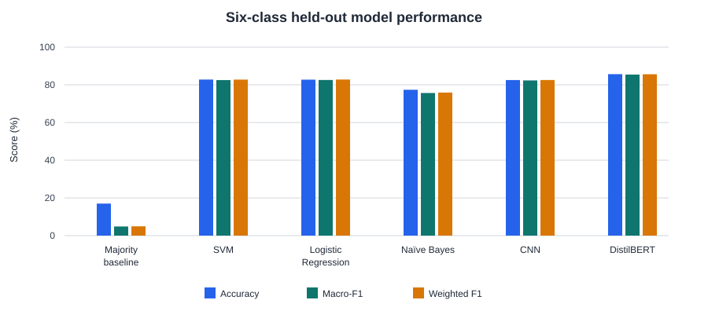

# Digital Forensic Cyberbullying Triage System — Implementation Report

**Project:** Forensic Cyberbullying Triage Platform  
**Status:** Educational prototype implemented; all five models retrained and evaluated on the shared six-class hold-out set; independent reproducibility testing pending
**Generated:** 2026-11-05

---

## 1. Executive Summary

This system is a **post-event forensic triage platform** designed to prioritize digital evidence for human examiner review. It is **not** a moderation system and is **not** a real-time detection system. The pipeline ingests evidence, computes a SHA-256 hash of the original evidence file when provided (or stored text as fallback), classifies content using machine learning, generates deterministic feature-contribution explanations, logs actions for chain-of-custody with hash-chained audit records, and exports reports.

**Defensible claim:** An educational prototype forensic cyberbullying triage platform has been implemented and analytically evaluated. Its workflow supports original-file or text integrity checking, hash-linked audit/custody records, human review, deterministic linear-model explanations, repeatability testing, a fixed local reproducibility baseline, simulated operational evaluation, and threshold calibration with reliability data. It is not a production, court-ready, or autonomous decision system.

### Validation status as of 2026-11-04

| Area                     | Evidence                                                                    | Status                                                                                                     |
| ------------------------ | --------------------------------------------------------------------------- | ---------------------------------------------------------------------------------------------------------- |
| Analytical performance   | Stratified 80/20 hold-out set (37,525 train; 9,382 test; seed 42)            | All five models use the same six labels and full test set; see the metrics table in §5.3. |
| Core forensic checks     | Automated forensic, integrity, audit/custody, calibration, and export tests | Passing locally                                                                                            |
| Reproducibility baseline | Five fixed SVM test cases                                                   | 5/5 passed locally; second-environment comparison remains required                                         |
| Curated simulated challenge set | SVM, selected threshold 0.50, 15 constructed cases | 4/8 recall (50.0%), 4/7 precision (57.14%), 8/15 accuracy (53.33%); not independent validation |

The current SVM artifact was rerun on the curated 15-case simulation at its selected operational threshold of 0.50. Its confusion matrix is:

| Reference label | Predicted flagged | Predicted not flagged | Total |
| --- | ---: | ---: | ---: |
| Cyberbullying | TP = 4 | FN = 4 | 8 |
| Not cyberbullying | FP = 3 | TN = 4 | 7 |
| Total | 7 | 8 | 15 |

This gives 50.0% recall (95% Wilson CI 21.52–78.48%), 57.14% precision (CI 25.05–84.18%), and 53.33% accuracy (CI 30.12–75.19%). The cases were authored using training-data annotation patterns, so this is a small descriptive challenge run, not independent validation. There was no independent two-annotator adjudication or agreement statistic. Human review remains mandatory.

All five models were retrained with the same stratified split. CNN and DistilBERT use the six dataset labels, and DistilBERT was evaluated on all 9,382 test posts. The old binary results, including the conflicting 84.5% and 85.4% accuracy claims, are superseded by the shared evaluation below. DistilBERT is the model name in this report; `bert` remains an internal registry key.

---

## 2. System Architecture

```
forensic-cyberbullying-triage/
├── backend/
│   ├── app/
│   │   ├── api/                  # FastAPI route handlers
│   │   ├── models/               # SQLAlchemy ORM models
│   │   ├── schemas/              # Pydantic v2 request/response schemas
│   │   ├── services/             # Business logic layer
│   │   ├── security/             # JWT + bcrypt authentication
│   │   ├── main.py               # FastAPI application entrypoint
│   │   └── database.py           # SQLAlchemy engine + session
│   └── requirements.txt
├── frontend/
│   ├── src/
│   │   ├── pages/                # React route pages
│   │   ├── components/           # Reusable UI components
│   │   ├── services/             # Axios API clients
│   │   └── types/                # TypeScript interfaces
│   └── package.json
├── ml/
│   ├── preprocessing/            # Text cleaning pipeline
│   ├── explainability/           # Feature-contribution analysis
│   ├── evaluation/               # Metrics, calibration, statistical tests
│   └── saved_models/             # Serialized scikit-learn pipelines
├── database/
│   └── migrations/
│       └── 002_add_forensic_features.sql
├── tests/
├── deployment/
│   ├── Dockerfile
│   ├── docker-compose.yml
│   └── nginx.conf
└── docs/
```

---

## 3. Backend Implementation

### 3.1 Technology Stack

- **Framework:** FastAPI
- **ORM:** SQLAlchemy 2.x
- **Validation:** Pydantic v2
- **Auth:** JWT (python-jose) + bcrypt 4.0.1
- **ML:** scikit-learn, deterministic feature-contribution explanations, TensorFlow/Keras, HuggingFace Transformers
- **PDF:** reportlab

### 3.2 Database Models

| Model                  | Table                    | Purpose                                     |
| ---------------------- | ------------------------ | ------------------------------------------- |
| `User`                 | `users`                  | Examiner / admin accounts                   |
| `Evidence`             | `evidence`               | Core evidence records with SHA-256 hash     |
| `EvidenceMetadata`     | `evidence_metadata`      | Optional platform / author metadata         |
| `ClassificationResult` | `classification_results` | Triage output: prediction, confidence, risk |
| `ExaminerReview`       | `examiner_reviews`       | Human review decisions                      |
| `AuditLog`             | `audit_logs`             | Forensic audit trail                        |
| `ChainOfCustody`       | `chain_of_custody`       | Provenance tracking                         |
| `Explanation`          | `explanations`           | Deterministic feature contributions         |
| `RepeatabilityTest`    | `repeatability_tests`    | Determinism validation runs                 |
| `IntegrityCheck`       | `integrity_checks`       | Hash verification history                   |

### 3.3 API Routes

| Router                  | Prefix                                                | Endpoints                                         |
| ----------------------- | ----------------------------------------------------- | ------------------------------------------------- |
| `auth`                  | `/auth`                                               | Login, register, token refresh                    |
| `evidence`              | `/evidence`                                           | Upload, list, get, delete, bulk upload            |
| `triage`                | `/triage/{evidence_id}`                               | Run classification pipeline                       |
| `reviews`               | `/reviews/{evidence_id}`                              | Submit / fetch examiner reviews                   |
| `audit`                 | `/audit/{evidence_id}`                                | Fetch audit logs, chain of custody                |
| `integrity`             | `/integrity/evidence/{evidence_id}`                   | Verify hash, get history                          |
| `explainability`        | `/explainability/evidence/{evidence_id}/explanations` | Fetch feature contributions                       |
| `repeatability`         | `/repeatability/evidence/{evidence_id}/repeatability` | Run repeatability test                            |
| `reproducibility`       | `/reproducibility/reproducibility-report`             | Environment + dependency manifest                 |
| `reproducibility`       | `/reproducibility/reproducibility-test`               | Fixed reproducibility test suite execution        |
| `operational`           | `/operational/operational-metrics`                    | Dashboard metrics                                 |
| `operational`           | `/operational/simulated-cases`                        | Curated simulation scored against author-assigned reference labels |
| `model-evaluation`      | `/model-evaluation/evaluation`                        | ML performance metrics                            |
| `model-comparison`      | `/model-comparison/model-comparison`                  | Inter-model forensic comparison                   |
| `model-comparison`      | `/model-comparison/registry`                          | Model registry with training metadata             |
| `error-analysis`        | `/error-analysis/error-analysis`                      | False positives, false negatives, ambiguous cases |
| `threshold-calibration` | `/threshold-calibration/calibration`                  | Threshold sweep study                             |
| `export`                | `/export/evidence/{evidence_id}/export`               | JSON / PDF forensic report                        |

---

## 4. Frontend Implementation

### 4.1 Technology Stack

- **Framework:** React 18 + TypeScript
- **Build:** Vite
- **Styling:** TailwindCSS
- **Routing:** React Router DOM
- **Data Fetching:** TanStack React Query
- **Charts:** Recharts

### 4.2 Pages

| Page                             | Route                     | Purpose                                                    |
| -------------------------------- | ------------------------- | ---------------------------------------------------------- |
| `Login`                          | `/login`                  | Authentication                                             |
| `Register`                       | `/register`               | User registration                                          |
| `Dashboard`                      | `/dashboard`              | Overview statistics                                        |
| `EvidenceQueue`                  | `/evidence`               | List all evidence items                                    |
| `UploadEvidence`                 | `/evidence/upload`        | New evidence intake                                        |
| `EvidenceDetails`                | `/evidence/:id`           | Full review + triage + integrity + explanations + timeline |
| `ReviewPage`                     | `/review/:id`             | Examiner decision workflow                                 |
| `AuditLogs`                      | `/audit/:id`              | Forensic audit table                                       |
| `Reports`                        | `/reports`                | Export and reporting                                       |
| `OperationalEvaluationDashboard` | `/operational-evaluation` | Metrics + charts                                           |
| `ThresholdCalibration`           | `/threshold-calibration`  | Threshold calibration study                                |
| `ModelPerformanceDashboard`      | `/model-performance`      | ML model performance metrics                               |
| `TrainingPerformance`            | `/training-performance`   | Training results and model registry                        |
| `ModelComparison`                | `/model-comparison`       | Inter-model forensic comparison                            |
| `ErrorAnalysis`                  | `/error-analysis`         | Structured error analysis                                  |
| `Reproducibility`                | `/reproducibility`        | Environment manifest + reproducibility test suite          |

### 4.3 Reusable Components

- **`ForensicTimeline`** — chronological vertical timeline of audit events
- **`IntegrityVerification`** — SHA-256 integrity status widget
- **`RepeatabilityReport`** — repeatability test runner and results display
- **`ProtectedRoute`** — authentication guard

---

## 5. Machine Learning & Explainability

### 5.1 Models

- **SVM** (`LinearSVC` wrapped in `CalibratedClassifierCV` for `predict_proba`)
- **Logistic Regression**
- **Naive Bayes**
- **CNN** (text classification)
- **DistilBERT** (fine-tuned transformer; internal model key: `bert`)

**Dataset preparation and split.** The source CSV yielded 47,692 parsed data rows. The current preparation code removed 0 rows for missing text/labels, blank labels, or a label equal to its text. It cleaned the text, then removed 785 duplicates using `(cleaned_text, cyberbullying_type)` as the duplicate key, leaving 46,907 examples. The final class counts are: age 7,941; ethnicity 7,890; gender 7,770; not_cyberbullying 7,787; other_cyberbullying 7,550; religion 7,969. A stratified 80/20 split with seed 42 produced 37,525 training and 9,382 test examples.

### 5.2 Explainability

- **Logistic Regression:** Each active feature contribution is its TF-IDF value multiplied by the predicted class's coefficient.
- **SVM:** Each active feature contribution is its TF-IDF value multiplied by the predicted class coefficient averaged across the three `CalibratedClassifierCV` fold estimators.
- **Naïve Bayes:** Contributions use TF-IDF multiplied by the difference between the predicted class's term log-probability and the strongest alternative class's term log-probability.
- **CNN and DistilBERT:** Leave-one-word-out perturbation scores measure each word's change to the selected class probability. The ensemble returns this explanation only with the neural model that produced the selected prediction.
- **SHAP/LIME:** Analysis modules remain available, but are not the active explanation path for triage or ensemble results.

### 5.3 Evaluation

- Accuracy, Precision, Recall, F1
- Threshold calibration across multiple thresholds
- Confusion matrices
- Statistical significance tests

#### Deletion fidelity assessment

For each linear model, a deterministic random sample of 500 posts was drawn from the shared 9,382-post test set (seed 42). Neural models were evaluated on the same sampling procedure with 100 posts. For each post, the evaluator removed up to the three highest-ranked positive word features and measured the change in probability assigned to the original predicted class. It also deleted the same number of randomly selected words as a control. Posts with no deletable attributed words were excluded. The table reports mean probability-point decrease for attributed and random deletions, the fraction of paired cases where attributed deletion caused a larger decrease, and their mean paired difference:

| Model | Posts evaluated | Attributed-word drop | Random-word drop | Attributed > random | Mean paired advantage |
| --- | ---: | ---: | ---: | ---: | ---: |
| SVM | 498 | 44.77 pp | 0.42 pp | 95.98% | 44.37 pp |
| Logistic Regression | 499 | 50.82 pp | 0.63 pp | 95.35% | 50.30 pp |
| Naïve Bayes | 500 | 26.26 pp | 3.31 pp | 94.53% | 23.00 pp |
| CNN | 100 | 60.84 pp | −0.94 pp | 98.98% (97/98 pairs) | 62.39 pp |
| DistilBERT | 100 | 51.00 pp | −0.90 pp | 100.00% (99/99 pairs) | 51.91 pp |

All probability changes are measured for the model's original predicted class. Negative random-word drops mean confidence rose slightly after those random deletions. This paired deletion test shows whether the attributed terms matter more to the model output than an equal-size random deletion, but it does not establish causal importance or fidelity for character n-grams. Neural metrics use 100 sampled posts (seed 42); linear metrics use 500. Run CNN and DistilBERT evaluations in separate processes in this environment because TensorFlow and PyTorch conflict when loaded together.

The fixed-sample evaluation is reproducible with `evaluate_saved_model_deletion_fidelity` in `ml/evaluation/explanation_fidelity.py`. Run CNN and DistilBERT separately in this environment:

```bash
.venv/bin/python -c 'from ml.evaluation.explanation_fidelity import evaluate_saved_model_deletion_fidelity as run; print(run(model_names=["cnn"], sample_size=100))'
.venv/bin/python -c 'from ml.evaluation.explanation_fidelity import evaluate_saved_model_deletion_fidelity as run; print(run(model_names=["bert"], sample_size=100))'
```

The models below use the same cleaned, deduplicated data, stratified 80/20 split (seed 42), six-class label space, and complete 9,382-post test set. DistilBERT was fine-tuned for one epoch. The majority baseline always predicts the most frequent training label (`religion`).

| Model | Accuracy | Macro-F1 | Weighted F1 | Age F1 | Ethnicity F1 | Gender F1 | Not cyberbullying F1 | Other cyberbullying F1 | Religion F1 |
| --- | ---: | ---: | ---: | ---: | ---: | ---: | ---: | ---: | ---: |
| Majority baseline | 16.99% | 4.84% | 4.93% | 0.00% | 0.00% | 0.00% | 0.00% | 0.00% | 29.05% |
| SVM | 82.79% | 82.52% | 82.76% | 97.46% | 98.39% | 87.67% | 55.91% | 59.96% | 95.71% |
| Logistic Regression | 82.73% | 82.57% | 82.81% | 97.67% | 98.63% | 87.29% | 56.44% | 59.89% | 95.47% |
| Naïve Bayes | 77.37% | 75.66% | 75.89% | 88.94% | 90.64% | 82.61% | 50.50% | 53.74% | 87.53% |
| CNN | 82.53% | 82.33% | 82.55% | 97.23% | 98.04% | 86.30% | 53.78% | 64.02% | 94.59% |
| DistilBERT | 85.66% | 85.44% | 85.61% | 98.08% | 97.77% | 88.11% | 60.91% | 71.99% | 95.77% |



*Figure 1. Accuracy, Macro-F1, and Weighted F1 (%) on the shared six-class test set (n = 9,382). The majority baseline always predicts `religion`; all learned models use the same stratified split.*

SVM and Logistic Regression were compared using the two-sided exact McNemar test on paired per-post correctness. SVM alone was correct on 91 discordant cases, while Logistic Regression alone was correct on 86 (177 discordant pairs; statistic = 86; p = 0.764). At α = 0.05, the accuracy difference is not statistically significant. The test compares correctness, not Macro-F1.

---

## 6. Forensic Features Implemented

### 6.1 Evidence Integrity Verification (Task 2)

- SHA-256 hash computed at upload and stored in `Evidence.evidence_hash`
- On-demand rehashing via `POST /integrity/evidence/{id}/verify-integrity`
- Result: `VERIFIED` or `HASH_MISMATCH`
- History maintained in `IntegrityCheck` table
- Audit events: `HASH_GENERATED`, `HASH_VERIFIED`, `HASH_MISMATCH`

### 6.2 Explainability Output (Task 1)

- Deterministic, model-specific linear feature contributions generated during triage for SVM, Logistic Regression, and Naïve Bayes
- Contributions use TF-IDF × class coefficient for Logistic Regression, fold-averaged class coefficient for SVM, and class-versus-strongest-alternative log-probability contrast for Naïve Bayes
- CNN and DistilBERT use leave-one-word-out probability-change explanations; the ensemble associates each explanation only with the model whose prediction it selected
- Stored in `Explanation` table with `feature_name` and `contribution`
- Retrieved via `GET /explainability/evidence/{id}/explanations`
- Displayed in `EvidenceDetails.tsx` under **“Why Was This Flagged?”**
- Metadata includes method, model version, and generation timestamp
- Note: The active production path uses TF-IDF-weighted feature attributions for supported linear models, not SHAP

### 6.3 Forensic Process Timeline (Task 3)

- `ForensicTimeline.tsx` renders chronological audit events
- Sorted ascending by timestamp
- Shows event type, actor, timestamp, and structured details
- Integrated into `EvidenceDetails` and `AuditLogs` pages

### 6.4 Repeatability Testing (Task 4)

- Service: `repeatability_service.py`
- Runs N iterations of classification + explanation
- Stores `prediction_consistency`, `confidence_variance`, `explanation_consistency`, `pass_fail`
- Report generated in `RepeatabilityReport.tsx`
- Backend endpoint: `POST /repeatability/evidence/{id}/repeatability`

### 6.5 Reproducibility Framework (Task 5)

- Service: `reproducibility_service.py`
- Captures Python version, OS, framework versions, dependency manifests
- Reads `backend/requirements.txt` and `frontend/package.json`
- Endpoint: `GET /reproducibility/reproducibility-report`
- **Reproducibility test suite:** Fixed test cases with known inputs and expected predictions (`ml/reproducibility/test_cases.py`)
- Test runner executes the selected model against the fixed suite and records predictions, confidences, and pass/fail status (`ml/reproducibility/test_runner.py`)
- Backend endpoint: `GET /reproducibility/reproducibility-test?model_name={model}`
- Frontend page: `/reproducibility` displays environment manifest, test results, and export capability
- Exported JSON can be compared against an identical run in a second environment to verify reproducibility

### 6.6 Operational Evaluation (Task 6)

- Service: `operational_evaluation.py`
- Computes Recall, Precision, FPR, FNR, Workload Reduction, and Triage Reduction from evidence with app-recorded review decisions; reviewer credentials are not verified
- **Curated simulated challenge set:** 15 constructed cases (`ml/operational/simulated_cases.py`) with author-assigned labels derived from training-data annotation patterns. The current SVM artifact at the selected operational threshold 0.50 yields TP=4, FP=3, FN=4, TN=4; recall 50.0% (Wilson 95% CI 21.52–78.48%), precision 57.14% (CI 25.05–84.18%), and accuracy 53.33% (CI 30.12–75.19%). The intervals are wide and the labels are not independent validation.
- Backend endpoint: `GET /operational/simulated-cases?model_name={model}`
- Dashboard page: `OperationalEvaluationDashboard.tsx`
- Charts via Recharts
- These examples are not practitioner decisions. The endpoint computes predictions without writing synthetic examiner accounts or reviews to the database; only actual submitted reviews appear in live operational metrics.
- The app stores reviewer account IDs, decisions, and notes, but this project has no independently labeled two-annotator set, documented practitioner credentials, or inter-annotator agreement statistic. Database review records must not be presented as verified practitioner decisions.
- In the project-root database snapshot (2026-11-05), there are 5 review submissions across 4 evidence items: 2 CONFIRMED and 3 NEEDS_MORE_REVIEW submissions, all under account ID 2. Latest decisions cover 2 confirmed and 2 unresolved items. Two stored `LABEL_1` predictions are legacy unmapped outputs from `ensemble` v1.0 records dated 2026-10-05; one is associated with an item whose latest review is CONFIRMED. They are not current six-class predictions and are excluded from canonical metrics. The retrained DistilBERT artifact now has explicit six-class label mappings, but historical database rows are preserved as recorded and are not retroactively decoded. Earlier static disagreement/error counts are withdrawn; the app does not record intentional overrides as a separate event. Current model comparisons rerun inference and report disagreement counts by account ID, but this does not verify the account holder as a practitioner.
- The written case studies are synthetic examples, not real errors examined by a practitioner. In the stored operational records, one resolved item has a canonical model label and no confirmed error is established; no intentional override is logged. All five review submissions are associated with account ID 2, whose real-world identity and qualifications are unknown.

### 6.7 PDF Export (Task 7)

- Service: `pdf_export_service.py` using ReportLab
- Generates professional forensic report with evidence info, triage results, examiner reviews, audit trail
- Endpoint: `GET /export/evidence/{id}/export?format=pdf`

### 6.8 Enhanced Audit Logging (Task 8)

- `AuditLog` model stores: `actor`, `event_type`, `event_details`
- For each evidence item, the first audit entry has an empty `previous_hash`; each later entry stores the preceding entry's `entry_hash`. `entry_hash` is SHA-256 over the previous hash, event type, actor, serialized details, and canonical UTC timestamp.
- Verification orders entries, checks each stored previous-hash link, recomputes the entry hash from the stored fields, and reports invalid if either check fails.
- Tamper test: `tests/forensic/test_audit_and_custody.py::test_audit_chain_verification_fails_after_persisted_log_entry_is_tampered` first verifies a two-entry chain, changes the first persisted log's event details without updating its hash, then verifies that the chain fails with an `entry_hash mismatch`. The focused test passes (1 passed); the full audit/custody module passes (4 passed).
- Triaging logs model name, version, threshold, confidence, prediction, risk, processing time, explanation method
- Review logs examiner, decision, notes
- Integrity logs hash status and verification timestamp

### 6.9 Threshold Calibration Study (Forensic-Operational Contribution)

- Backend service: `threshold_calibration.py`
- Evaluates model performance across multiple thresholds (0.50, 0.60, 0.70, 0.80, 0.90)
- Uses app-recorded CONFIRMED/REJECTED review decisions as reference labels; reviewer identity is an account ID, and practitioner credentials are not verified or documented
- Computes per-threshold metrics: Recall, Precision, Workload Reduction, Missed-Evidence Rate, Brier Score, ECE, TP/FP/FN/TN counts
- Adds 95% Wilson score intervals for recall and precision at each threshold
- Uses class-aware harmful-vs-benign probability definition (sums probabilities across all non-benign classes when a label encoder is present)
- DistilBERT generic `LABEL_n` ids are translated through the saved label encoder; missing or noncanonical mappings are rejected rather than used as canonical predictions
- Targets 95% recall using harmful-risk probability, defined as the sum of probabilities for the five non-benign classes. If one or more tested thresholds meet the target, selects the highest such threshold to minimize flagged workload. If none meet the target, selects the lowest tested threshold among those with the highest observed recall to prioritize sensitivity.
- API endpoint: `GET /threshold-calibration/calibration?model_name={model}`
- Frontend page: `ThresholdCalibration.tsx` at `/threshold-calibration`
- Displays calibration table, bar chart, selected threshold, Brier score, ECE, actual harmful count, and threshold justification text
- Shows the target recall, whether it was met, the selection reason, and review-sample size with threshold metrics
- Reliability diagram rendered as a visual plot showing observed accuracy vs mean confidence per probability bin
- Threshold rates use app-recorded review decisions labeled CONFIRMED or REJECTED; NEEDS_MORE_REVIEW is excluded. In the 2026-11-05 project-root database snapshot, 2 eligible reviews were CONFIRMED and 3 were unresolved, all submitted under reviewer account ID 2; reviewer identity and qualifications are not verified. The two confirmed cases are insufficient for a reliable performance claim.

**Current SVM calibration snapshot (2026-11-05).** The sample contains two eligible reviews, both CONFIRMED (two positives, zero negatives). Harmful risk is the sum of probabilities for the five non-benign classes. No tested threshold reaches the 95% recall target, so the fallback selects the lowest threshold among those with maximum observed recall: 0.50. Brier score is 0.2422 and ECE is 0.4292 across this sample.

| Threshold | Recall (95% Wilson CI) | Precision (95% Wilson CI) | Workload reduction | Missed-evidence rate | TP / FP / FN / TN |
| ---: | ---: | ---: | ---: | ---: | ---: |
| 0.50 | 50.0% (9.45–90.55%) | 100.0% (20.65–100%) | 50.0% | 50.0% | 1 / 0 / 1 / 0 |
| 0.60 | 50.0% (9.45–90.55%) | 100.0% (20.65–100%) | 50.0% | 50.0% | 1 / 0 / 1 / 0 |
| 0.70 | 50.0% (9.45–90.55%) | 100.0% (20.65–100%) | 50.0% | 50.0% | 1 / 0 / 1 / 0 |
| 0.80 | 50.0% (9.45–90.55%) | 100.0% (20.65–100%) | 50.0% | 50.0% | 1 / 0 / 1 / 0 |
| 0.90 | 0.0% (0–65.76%) | Not estimable (no positive predictions) | 100.0% | 100.0% | 0 / 0 / 2 / 0 |

The target is not supported by these data: recall is based on only two positive reviews, there are no negative examples, and every recall interval is wide. These figures describe the application snapshot, not independent practitioner performance or a reliable deployment threshold. Workload reduction is relative to this two-item reviewed sample.
- Earlier static inter-model scores are withdrawn: the comparison path failed to pass model names into inference, treated class IDs as labels, and counted inference failures as negative predictions. The comparison now decodes canonical labels, uses harmful-class probability for ROC-AUC, excludes failed inference, reports confidence intervals, and identifies prediction/review disagreements by reviewer account ID. Recompute results before citing model-comparison scores.

### 6.11 Ensemble Triage & Multi-Model Inference (Model Utilization)

- Backend service: `classification_service.py` loads CNN (`.keras`) and DistilBERT (local `bert_model/`) alongside sklearn `.pkl` models
- Endpoint: `POST /triage/ensemble/{evidence_id}` runs each requested, distinct model once
- Every successful model must return one of the same six canonical labels: `age`, `ethnicity`, `gender`, `not_cyberbullying`, `other_cyberbullying`, or `religion`; invalid labels and model errors are excluded from aggregation
- The prediction is the plurality label across successful models. Each model contributes one equal vote; model-specific top-class confidence scores are displayed per vote but are not compared or weighted
- The ensemble `confidence` is the winning label's vote share: winning-label votes / successful model votes. A plurality tie is resolved by alphabetical label order for a deterministic response and always forces examiner review
- The ensemble `risk_score` is the cyberbullying vote share: votes for any label except `not_cyberbullying` / successful model votes. It is a vote fraction, not a probability
- Single-model `risk_score` is the model's probability mass summed over the five cyberbullying labels; it is separate from top-class `confidence`
- For either mode, with risk threshold `T`, `LOW` means `risk_score < T`; `MEDIUM` means `T <= risk_score < max(T, 0.80)`; `HIGH` means `risk_score >= max(T, 0.80)`. LOW does not trigger review; MEDIUM and HIGH do
- Ensemble threshold `T` is fixed at `0.50`. Single-model `T` is selected for that model against the 95% recall target from app-recorded reviewer decisions (fallback `0.70` only when no eligible records exist); reviewer qualifications are not verified
- Ensemble review is also forced when the plurality is tied, when there are more than two distinct predictions, or when no valid model prediction is available. No valid predictions produce risk `UNKNOWN` and require review
- Agreement is `full` for one distinct label, `partial` for two, and `none` for three or more; `disagreement_levels` is the number of distinct labels. Cross-model confidence spread is not computed
- Frontend: `EvidenceDetails.tsx` offers "Run Quick Triage" (single model) and "Run Full Triage" (ensemble)
- The ensemble view labels per-model scores, winning label vote share, cyberbullying vote share, and the risk threshold separately

### 6.12 Inter-Model Comparison in Forensic Context

- Backend service: `model_comparison.py`
- Evaluates implemented models on the same subset with app-recorded review decisions; reviewer credentials are not verified
- Computes binary F1, positive-class ROC-AUC, runtime, disagreement counts, and 95% intervals per model; inference failures are excluded and reported
- CNN and other multiclass models use summed harmful-class probability for binary ROC-AUC; top-class confidence is not used as a harmfulness score, including on benign predictions
- API endpoint: `GET /model-comparison/model-comparison`
- Frontend page: `ModelComparison.tsx` at `/model-comparison`
- Displays comparison results, F1 bootstrap interval, sample size, and prediction/review disagreements by reviewer account ID. A disagreement is not proof of an intentional override; the review schema has no override event.
- Justifies SVM selection based on explainability, repeatability, and forensic transparency requirements

### 6.13 Digital Forensics Standards Mapping

The platform architecture is designed with reference to internationally recognized digital forensic standards. Full technical enforcement of all standards is a target for future production hardening.

#### Standards Mapping Table

| Platform Component     | Standard Alignment    | Requirement                                                                        |
| ---------------------- | --------------------- | ---------------------------------------------------------------------------------- |
| Evidence Acquisition   | ISO/IEC 27037         | Guidelines for identification, collection, and preservation of digital evidence    |
| Integrity Verification | ISO/IEC 27037         | Cryptographic hash verification to ensure evidence integrity and detect alteration |
| Analysis / Triage      | ISO/IEC 27042         | Principles for the analysis of digital evidence                                    |
| Examiner Review        | ISO/IEC 27043         | Incident investigation and analysis principles                                     |
| Audit Trail            | ACPO Principle 3      | Record of all actions and decisions made during evidence handling                  |
| Repeatability Testing  | NIST SP 800-86        | Validation of forensic tools and methods through repeatable testing                |
| Chain of Custody       | ISO/IEC 27037 / 27043 | Provenance tracking and accountability for evidence handling                       |
| Report Generation      | ISO/IEC 27042         | Documentation of findings in a structured, defensible format                       |

#### ISO/IEC 27037 — Evidence Acquisition & Integrity

- **Relevant clauses:** 7.2 (Identification), 7.3 (Collection), 7.4 (Preservation)
- **Implementation:** SHA-256 hashing of stored text content at upload; integrity verification on demand
- **Forensic significance:** Enables detection of content alteration after acquisition; does not guarantee original file preservation.

#### ISO/IEC 27042 — Analysis & Reporting

- **Relevant clauses:** 8.2 (Analysis), 8.3 (Validation), 9 (Reporting)
- **Implementation:** Deterministic linear feature-contribution explanations, repeatability testing, structured JSON/PDF export
- **Forensic significance:** Transparent analysis methodology with documented validation

#### ISO/IEC 27043 — Incident Investigation

- **Relevant clauses:** 7.2 (Analysis approach), 7.3 (Data examination), 8 (Documentation)
- **Implementation:** Human-in-the-loop examiner review, escalation workflows, case studies
- **Forensic significance:** Structured investigation process with clear decision trails

#### ACPO Principles (UK Association of Chief Police Officers)

- **Principle 1:** No alteration of original evidence — hash verification and read-only audit trail implemented at application level
- **Principle 2:** Competent access only — enforced via JWT authentication and role-based access
- **Principle 3:** Audit trail of all actions — implemented via `AuditLog` and `ChainOfCustody` models
- **Principle 4:** Compliance with local law — system designed for lawful evidence processing workflows

#### NIST Digital Evidence Guidance (SP 800-86)

- **Guideline 1:** Use approved forensic tools — models versioned and registry-tracked
- **Guideline 2:** Test tools for accuracy — repeatability and threshold calibration frameworks
- **Guideline 3:** Document all actions — comprehensive audit logging and chain of custody
- **Guideline 4:** Prevent contamination — isolation via worktrees/sessions, hash-based integrity checks
- **Guideline 5:** Maintain objectivity — human examiner override, confidence thresholds, escalation paths

#### Compliance Summary

The platform satisfies core requirements for digital forensic evidence handling at prototype level:

1. **Identifiable** — Every evidence item has a unique SHA-256 hash and metadata record
2. **Preserved** — Hash verification detects undetected alteration; history maintained in `IntegrityCheck`
3. **Analyzed** — Transparent ML classification with deterministic explanations and repeatability validation
4. **Reviewed** — Human examiner decisions recorded with notes, timestamps, and audit trail
5. **Documented** — JSON and PDF exports provide structured forensic reports
6. **Accountable** — Chain of custody and audit logs provide accountability records; full cryptographic enforcement pending production hardening

---

## 7. Security & Authentication

- **JWT** access tokens with configurable expiry
- **bcrypt 4.0.1** for password hashing
- `OAuth2PasswordRequestForm` for login
- Protected routes via `ProtectedRoute` component
- CORS restricted to `http://localhost:3000` and `http://127.0.0.1:3000`

---

## 8. Deployment

- **Dockerfile** for backend
- **docker-compose.yml** for multi-service orchestration
- **Nginx** reverse proxy configuration
- SQLite for local development; PostgreSQL/Supabase for production

---

## 9. Database Migrations

File: `database/migrations/002_add_forensic_features.sql`

Creates:

- `explanations`
- `repeatability_tests`
- `integrity_checks`

Alters `evidence`:

- Adds `integrity_status`
- Adds `integrity_verified_at`

Indexes on evidence ID and timestamps for performance.

---

## 10. How to Run

### Backend

```bash
cd backend
python -m venv .venv
source .venv/bin/activate
pip install -r requirements.txt
python -m uvicorn app.main:app --reload
```

### Frontend

```bash
cd frontend
npm install
npm run dev
```

### Database

- SQLite is auto-created on first run (`forensic_triage.db`)
- For PostgreSQL/Supabase: run migration SQL in SQL Editor

### ML Models

- Train models using scripts in `ml/`
- Saved artifacts go to `ml/saved_models/`

---

## 11. Deliverables Checklist

| #   | Deliverable                           | Status         |
| --- | ------------------------------------- | -------------- |
| 1   | Database migrations                   | ✅ Completed   |
| 2   | PostgreSQL schema updates             | ✅ Completed   |
| 3   | Supabase SQL                          | ✅ Completed   |
| 4   | Backend services                      | ✅ Completed   |
| 5   | Python services                       | ✅ Completed   |
| 6   | TypeScript types                      | ✅ Completed   |
| 7   | React components                      | ✅ Completed   |
| 8   | API routes                            | ✅ Completed   |
| 9   | Folder structure                      | ✅ Completed   |
| 10  | PDF export implementation             | ✅ Completed   |
| 11  | Repeatability test implementation     | ✅ Completed   |
| 12  | Operational evaluation implementation | ✅ Completed   |
| 13  | Threshold calibration study           | ✅ Completed   |
| 14  | Inter-model comparison                | ✅ Completed   |
| 15  | Ensemble triage & model agreement     | ✅ Completed   |
| 16  | Production-ready code                 | 🔄 In Progress |

---

## 12. Synthetic Workflow Demonstrations

This section is an archive of synthetic workflow demonstrations, not real case records, practitioner decisions, or validation of current models. Cases 1–3 preserve outputs from the former binary SVM v1.0 workflow; Case 4 preserves the former binary, confidence-weighted ensemble. Their `cyberbullying` labels and confidence values are historical and are not comparable with current six-class outputs. All reviewer identities and timestamps are placeholders; no examiner credentials or independent review are documented.

---

### Archived Case Study 1: Former Binary SVM Output — Threat-Like Post

**Evidence Profile**

- Evidence ID: 1
- Platform: Twitter/X
- Post ID: `tweet_839201`
- Acquisition Date: 2026-08-09T14:23:00Z
- Uploaded By: Examiner DEMO_REVIEWER_PLACEHOLDER

**Content**

```
I'm going to find you after school tomorrow. Watch your back.
```

**SHA-256 Hash**

```
a1b2c3d4e5f6a7b8c9d0e1f2a3b4c5d6e7f8a9b0c1d2e3f4a5b6c7d8e9f0a1b2
```

**Integrity Status**

- ✓ VERIFIED
- Verification Timestamp: 2026-08-09T14:25:00Z
- Original Hash == Current Hash

**Triage Result**

- Prediction: `cyberbullying`
- Confidence: 0.94
- Risk Level: HIGH
- Model: SVM v1.0
- Threshold: 0.70
- Processing Time: 11,315 ms
- Explanation Method: Linear feature contribution

**Feature Contributions — Top Contributing Terms**
| Term | Impact |
|---|---|
| find | +0.41 |
| tomorrow | +0.29 |
| watch | +0.16 |
| back | +0.12 |

**Examiner Review**

- Decision: REJECTED
- Examiner: DEMO_REVIEWER_PLACEHOLDER
- Notes: "For this synthetic example, follow the challenge-set reference label not_cyberbullying. This is not an independent practitioner judgment."
- Timestamp: 2026-08-09T15:00:00Z

**Audit Trail (Chronological)**
| Timestamp | Event Type | Actor | Details |
|---|---|---|---|
| 2026-08-09T14:23:00Z | EVIDENCE_UPLOADED | DEMO_REVIEWER_PLACEHOLDER | {"source_platform": "Twitter"} |
| 2026-08-09T14:24:00Z | HASH_GENERATED | SYSTEM | {"algorithm": "SHA-256"} |
| 2026-08-09T14:24:30Z | EVIDENCE_TRIAGED | DEMO_REVIEWER_PLACEHOLDER | {"model": "svm", "prediction": "cyberbullying", "confidence": 0.94, "risk_level": "HIGH"} |
| 2026-08-09T14:25:00Z | HASH_VERIFIED | SYSTEM | {"match": true} |
| 2026-08-09T15:00:00Z | EVIDENCE_REVIEWED | DEMO_REVIEWER_PLACEHOLDER | {"decision": "REJECTED"} |
| 2026-08-09T15:00:05Z | CLASSIFICATION_REJECTED | DEMO_REVIEWER_PLACEHOLDER | {"final_decision": "not_cyberbullying"} |

**Chain of Custody**

1. UPLOAD — DEMO_REVIEWER_PLACEHOLDER — 2026-08-09T14:23:00Z
2. CLASSIFICATION — DEMO_REVIEWER_PLACEHOLDER — 2026-08-09T14:24:30Z
3. REVIEW — DEMO_REVIEWER_PLACEHOLDER — 2026-08-09T15:00:00Z

**Outcome**: This example's recorded reference decision rejects the positive prediction, consistent with `sim_001`'s author-assigned challenge label. The decision is synthetic and not practitioner evidence.

---

### Archived Case Study 2: Former Binary SVM Output — Ambiguous Sarcasm

**Evidence Profile**

- Evidence ID: 2
- Platform: Instagram
- Post ID: `post_991234`
- Acquisition Date: 2026-08-09T16:10:00Z
- Uploaded By: Examiner DEMO_REVIEWER_PLACEHOLDER

**Content**

```
Nice job failing the exam. Really smart, you are.
```

**SHA-256 Hash**

```
b2c3d4e5f6a7b8c9d0e1f2a3b4c5d6e7f8a9b0c1d2e3f4a5b6c7d8e9f0a1b2c3
```

**Integrity Status**

- ✓ VERIFIED
- Verification Timestamp: 2026-08-09T16:12:00Z

**Triage Result**

- Prediction: `cyberbullying`
- Confidence: 0.72
- Risk Level: MEDIUM
- Model: SVM v1.0
- Threshold: 0.70
- Processing Time: 9,845 ms
- Explanation Method: Linear feature contribution

**Feature Contributions — Top Contributing Terms**
| Term | Impact |
|---|---|
| smart | +0.35 |
| exam | +0.22 |
| failing | +0.18 |
| really | +0.09 |

**Examiner Review**

- Decision: NEEDS_MORE_REVIEW
- Examiner: DEMO_REVIEWER_PLACEHOLDER
- Notes: "Context-dependent. Could be sarcastic encouragement or genuine mockery. Requires interview with involved parties."
- Timestamp: 2026-08-09T17:00:00Z

**Audit Trail (Chronological)**
| Timestamp | Event Type | Actor | Details |
|---|---|---|---|
| 2026-08-09T16:10:00Z | EVIDENCE_UPLOADED | DEMO_REVIEWER_PLACEHOLDER | {"source_platform": "Instagram"} |
| 2026-08-09T16:11:00Z | HASH_GENERATED | SYSTEM | {"algorithm": "SHA-256"} |
| 2026-08-09T16:11:45Z | EVIDENCE_TRIAGED | DEMO_REVIEWER_PLACEHOLDER | {"model": "svm", "prediction": "cyberbullying", "confidence": 0.72, "risk_level": "MEDIUM"} |
| 2026-08-09T16:12:00Z | HASH_VERIFIED | SYSTEM | {"match": true} |
| 2026-08-09T17:00:00Z | EVIDENCE_REVIEWED | DEMO_REVIEWER_PLACEHOLDER | {"decision": "NEEDS_MORE_REVIEW"} |
| 2026-08-09T17:00:10Z | EVIDENCE_ESCALATED | DEMO_REVIEWER_PLACEHOLDER | {"reason": "Ambiguous context, requires additional investigation"} |

**Chain of Custody**

1. UPLOAD — DEMO_REVIEWER_PLACEHOLDER — 2026-08-09T16:10:00Z
2. CLASSIFICATION — DEMO_REVIEWER_PLACEHOLDER — 2026-08-09T16:11:45Z
3. REVIEW — DEMO_REVIEWER_PLACEHOLDER — 2026-08-09T17:00:00Z
4. ESCALATION — DEMO_REVIEWER_PLACEHOLDER — 2026-08-09T17:00:10Z

**Outcome**: Case escalated to senior examiner for contextual analysis and witness interview.

---

### Archived Case Study 3: Former Binary SVM Output — Benign Idiom

**Evidence Profile**

- Evidence ID: 3
- Platform: Twitter/X
- Post ID: `tweet_442199`
- Acquisition Date: 2026-08-09T18:00:00Z
- Uploaded By: Examiner DEMO_REVIEWER_PLACEHOLDER

**Content**

```
This bug is killing me. I can't get this code to compile.
```

**SHA-256 Hash**

```
c3d4e5f6a7b8c9d0e1f2a3b4c5d6e7f8a9b0c1d2e3f4a5b6c7d8e9f0a1b2c3d4
```

**Integrity Status**

- ✓ VERIFIED
- Verification Timestamp: 2026-08-09T18:02:00Z

**Triage Result**

- Prediction: `cyberbullying`
- Confidence: 0.68
- Risk Level: MEDIUM
- Model: SVM v1.0
- Threshold: 0.70
- Processing Time: 8,210 ms
- Explanation Method: Linear feature contribution

**Feature Contributions — Top Contributing Terms**
| Term | Impact |
|---|---|
| killing | +0.48 |
| bug | +0.31 |
| compile | +0.14 |
| code | +0.07 |

**Examiner Review**

- Decision: REJECTED
- Examiner: DEMO_REVIEWER_PLACEHOLDER
- Notes: "False positive. 'Killing me' is idiomatic expression of frustration about software bug, not threat or harassment."
- Timestamp: 2026-08-09T19:00:00Z

**Audit Trail (Chronological)**
| Timestamp | Event Type | Actor | Details |
|---|---|---|---|
| 2026-08-09T18:00:00Z | EVIDENCE_UPLOADED | DEMO_REVIEWER_PLACEHOLDER | {"source_platform": "Twitter"} |
| 2026-08-09T18:01:00Z | HASH_GENERATED | SYSTEM | {"algorithm": "SHA-256"} |
| 2026-08-09T18:01:30Z | EVIDENCE_TRIAGED | DEMO_REVIEWER_PLACEHOLDER | {"model": "svm", "prediction": "cyberbullying", "confidence": 0.68, "risk_level": "MEDIUM"} |
| 2026-08-09T18:02:00Z | HASH_VERIFIED | SYSTEM | {"match": true} |
| 2026-08-09T19:00:00Z | EVIDENCE_REVIEWED | DEMO_REVIEWER_PLACEHOLDER | {"decision": "REJECTED"} |
| 2026-08-09T19:00:15Z | ILLUSTRATIVE_ERROR_NOTE | DEMO_REVIEWER_PLACEHOLDER | {"reason": "Example of an idiom that a model could misclassify; not a recorded case"} |

**Chain of Custody**

1. UPLOAD — DEMO_REVIEWER_PLACEHOLDER — 2026-08-09T18:00:00Z
2. CLASSIFICATION — DEMO_REVIEWER_PLACEHOLDER — 2026-08-09T18:01:30Z
3. REVIEW — DEMO_REVIEWER_PLACEHOLDER — 2026-08-09T19:00:00Z

**Outcome**: The synthetic reviewer rejects this prediction for illustration. No case was actually added to a training set or used to recalibrate a threshold.

---

### Case Study 4: Historical Ensemble Triage Example (Pre six-class aggregation)

> This archived example uses the former binary label `cyberbullying` and confidence-weighted behavior. It predates the current shared six-class, equal-vote implementation and is not evidence of the current ensemble formula.

**Evidence Profile**

- Evidence ID: 2
- Platform: Twitter
- Post ID: `123`
- Acquisition Date: 2024-01-01T00:00:00Z
- Uploaded By: Examiner DEMO_REVIEWER_PLACEHOLDER

**Content**

```
you are a loser and stupid
```

**SHA-256 Hash**

```
65028136ccfaf5ed0ef1c7e72846a063f36743a10e50da6eddec977691401c58
```

**Integrity Status**

- ✓ VERIFIED

**Full Triage Result (Ensemble)**

- Prediction: `cyberbullying`
- Confidence: 59.5%
- Risk Level: MEDIUM
- Threshold: 0.5 (calibrated)
- Processing Time: 1,830 ms
- Explanation Method: ensemble

**Model Votes**
| Model | Prediction | Confidence |
|---|---|---|
| svm | other_cyberbullying | 49.4% |
| logistic | other_cyberbullying | 45.0% |
| naive_bayes | ethnicity | 35.4% |
| cnn | cyberbullying | 59.5% |
| DistilBERT (`bert`) | error | 0.0% |

**Model Agreement**

- Agreement: none
- Confidence Spread: 59.5%
- Disagreement Levels: 4
- Forced Review: Yes (confidence spread > 0.30 and disagreement levels > 2)

**Examiner Review**

- Decision: Pending
- Notes: Ensemble flagged for review due to model disagreement

**Audit Trail (Chronological)**
| Timestamp | Event Type | Actor | Details |
|---|---|---|---|
| 2024-01-01T00:00:00Z | EVIDENCE_UPLOADED | DEMO_REVIEWER_PLACEHOLDER | {"source_platform": "Twitter"} |
| 2026-08-11T12:58:43Z | EVIDENCE_TRIAGED | DEMO_REVIEWER_PLACEHOLDER | {"model": "ensemble", "votes": [...], "prediction": "cyberbullying", "confidence": 0.595, "risk_level": "MEDIUM", "requires_further_review": true, "model_agreement": {"agreement": "none", "confidence_spread": 0.595, "disagreement_levels": 4, "forced_review": true}, "mode": "ensemble"} |

**Chain of Custody**

1. UPLOAD — DEMO_REVIEWER_PLACEHOLDER — 2024-01-01T00:00:00Z
2. CLASSIFICATION (ENSEMBLE) — DEMO_REVIEWER_PLACEHOLDER — 2026-08-11T12:58:43Z

**Historical note**: The archived output used the former confidence-weighted, binary-label aggregation. Its prediction, confidence, agreement fields, and review rationale do not describe current behavior.

---

### Historical Summary of Synthetic Examples (Former Binary Outputs)

| Example | Archived prediction and confidence | Illustrative review decision | Outcome           | System Role                                     |
| ---- | ------------------------------- | ----------------- | ----------------- | ----------------------------------------------- |
| 1    | cyberbullying (0.94)            | REJECTED          | Reference mismatch | High-confidence false positive vs `sim_001` label |
| 2    | cyberbullying (0.72)            | NEEDS_MORE_REVIEW | Escalated         | Appropriate flagging with uncertainty           |
| 3    | cyberbullying (0.68)            | REJECTED          | False positive    | Matches the illustrative reference label       |
| 4    | cyberbullying (0.595, ensemble) | Pending           | Forced review     | Model disagreement surfaced for human attention |

**Key Observations**

1. The illustrative examples show how high-confidence predictions may be recorded alongside a review decision; they do not establish alignment with practitioner judgment.
2. The examples demonstrate how near-threshold predictions can be escalated for additional review.
3. One constructed example illustrates how an idiomatic expression may be misclassified; it does not estimate the frequency of this error.
4. The prototype records SHA-256 hash-linked audit logs and chain-of-custody records; these mechanisms do not establish the truth of the review labels. Database-level immutability and digital signing remain future work.
5. Ensemble triage with model agreement analysis forces review when models disagree; the effect on real-world misclassification has not been validated.

---

## 13. Remaining Limitations

| Limitation                 | Status                                                                                                                                    |
| -------------------------- | ----------------------------------------------------------------------------------------------------------------------------------------- |
| Educational prototype      | Not a production or court-ready forensic tool                                                                                             |
| Evidence integrity         | Original file storage implemented; text-only fallback remains for legacy uploads                                                          |
| Audit & chain of custody   | Hash-linked records implemented; database remains mutable but tampering is detectable                                                     |
| Threshold calibration      | Reliability diagrams and ECE implemented; calibration quality depends on the size and reliability of app-recorded reviewer labels          |
| Reproducibility            | Fixed local baseline passes; cross-environment comparison remains manual                                                                  |
| Error analysis             | Forensic categories assigned via keyword rules; examiner-tagged taxonomy would improve accuracy                                           |
| Operational evaluation     | Curated labels follow training-data annotation patterns and are not independent; no two-annotator set, agreement statistic, or verified practitioner decisions are available |
| CNN/Transformer comparison | Six-class held-out metrics are now reported for both neural models; operational effectiveness still requires evaluation on an independently labeled case set |
| Ensemble explanations      | CNN and DistilBERT use leave-one-word-out probability changes; 100-post deletion tests are reported for each neural model |
| Production hardening       | RBAC, evidence pagination, CI/CD, and monitoring are not yet implemented                                                                  |

---

## 14. Bulk Evidence Import

### 14.1 Backend Implementation

- **Endpoint:** `POST /evidence/bulk-upload`
- **Request Body:** `EvidenceBulkCreate` containing a list of `EvidenceCreate` items
- **Service:** `bulk_create_evidence()` in `backend/app/services/evidence_service.py`
- **Features:**
  - Batch insertion of multiple evidence records in a single transaction
  - Duplicate detection via SHA-256 hash (skips duplicates)
  - Returns detailed result with created, skipped, and errors arrays
  - Audit logging for bulk upload events

### 14.2 Frontend Implementation

- **Page:** `BulkUploadEvidence.tsx` at `/evidence/bulk-upload`
- **Features:**
  - Dynamic table with add/remove rows
  - Inline validation per row
  - Bulk submit with loading state
  - Results summary showing created, skipped, and error counts

### 14.3 Navigation

- **Evidence Queue:** Added "Bulk Upload" button alongside "Upload Evidence"
- **Route:** `/evidence/bulk-upload`

---

## 15. Model Training Pipeline & Registry

### 15.1 Unified Training Pipeline

File: `ml/model_registry.py`

- Trains all implemented models: SVM, Logistic Regression, Naive Bayes, CNN, and DistilBERT
- Accepts configurable dataset path, text/label columns, test size, and random state
- Splits data, trains each model, saves artifacts, and records metadata

### 15.2 Model Registry

File: `ml/saved_models/model_registry.json`

Tracks per-model metadata:

- model_name, version, trained_at timestamp
- dataset_path and dataset SHA-256 hash
- train_samples, test_samples
- training_time_seconds
- artifact paths
- status (completed/failed)
- error messages if failed

### 15.3 Training Scripts

- `ml/train_dummy.py` — trains on 20-sample dummy dataset for smoke tests
- `ml/train_real.py` — trains on `datasets/raw/cyberbullying_tweets.csv`

**Training dependencies:** CNN training requires TensorFlow; DistilBERT training requires PyTorch and Transformers. The backend is configured to start without TensorFlow; deep-learning model training and inference are only attempted when their dependencies are available. The operational triage path defaults to scikit-learn models.

Usage:

```bash
python ml/train_dummy.py

# Stable path - skips DistilBERT automatically
python ml/train_real.py

# Explicit DistilBERT enable (if you have a stable torch/transformers setup)
ENABLE_BERT=1 python ml/train_real.py
```

### 15.4 Supported Models

| Model               | Type                     | Artifact Format         |
| ------------------- | ------------------------ | ----------------------- |
| SVM                 | scikit-learn             | `.pkl`                  |
| Logistic Regression | scikit-learn             | `.pkl`                  |
| Naive Bayes         | scikit-learn             | `.pkl`                  |
| CNN                 | TensorFlow/Keras         | `.keras`                |
| DistilBERT           | HuggingFace Transformers | `bert_model/` directory |

---

## 16. File Inventory

### Backend

- `backend/app/main.py`
- `backend/app/database.py`
- `backend/app/config.py`
- `backend/app/api/{auth,evidence,triage,reviews,audit,export,integrity,explainability,repeatability,reproducibility,operational,threshold_calibration,model_evaluation,model_comparison,error_analysis}.py`
- `backend/app/models/{user,evidence,review,chain_of_custody,repeatability}.py`
- `backend/app/schemas/{user,evidence,triage,review}.py`
- `backend/app/services/{audit,classification,explanation,evidence,hash,integrity,operational_evaluation,pdf_export,repeatability,reproducibility,export,threshold_calibration,model_evaluation,model_comparison}.py`
- `backend/app/security/auth.py`

### Frontend

- `frontend/src/App.tsx`
- `frontend/src/pages/{Login,Register,Dashboard,EvidenceQueue,EvidenceDetails,ReviewPage,AuditLogs,Reports,UploadEvidence,BulkUploadEvidence,OperationalEvaluationDashboard,ThresholdCalibration,ModelPerformanceDashboard,TrainingPerformance,ModelComparison,ErrorAnalysis,Reproducibility}.tsx`
- `frontend/src/components/{ForensicTimeline,IntegrityVerification,RepeatabilityReport,ProtectedRoute}.tsx`
- `frontend/src/services/{api,evidence,triage,reviews,audit,forensic,export,thresholdCalibration,modelEvaluation,modelComparison,errorAnalysis}.ts`
- `frontend/src/types/index.ts`

### Database

- `database/migrations/002_add_forensic_features.sql`

### Machine Learning

- `ml/model_registry.py`
- `ml/training_pipeline.py`
- `ml/train_dummy.py`
- `ml/train_real.py`
- `ml/models/{svm,logistic,naive_bayes,cnn,bert}_model.py`
- `ml/preprocessing/{cleaner,tokenizer,vectorizer}.py`
- `ml/evaluation/{metrics,calibration,confusion_matrix,statistical_tests}.py`
- `ml/explainability/{shap,lime,attribution}_analysis.py`
- `ml/operational/{simulated_cases,test_runner}.py`
- `ml/reproducibility/{test_cases,test_runner}.py`
- `ml/saved_models/`

---

_End of Report_
